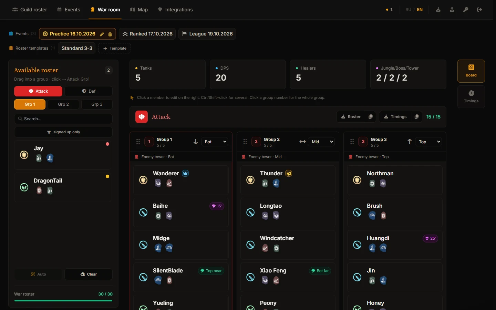
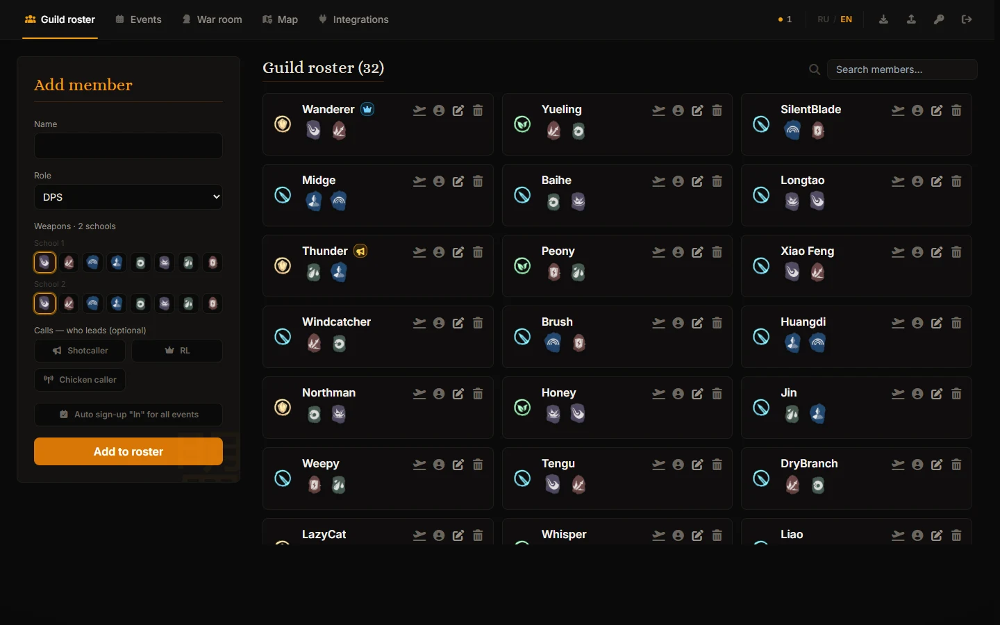
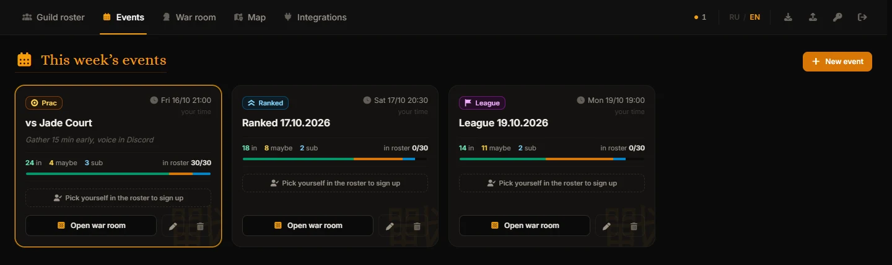
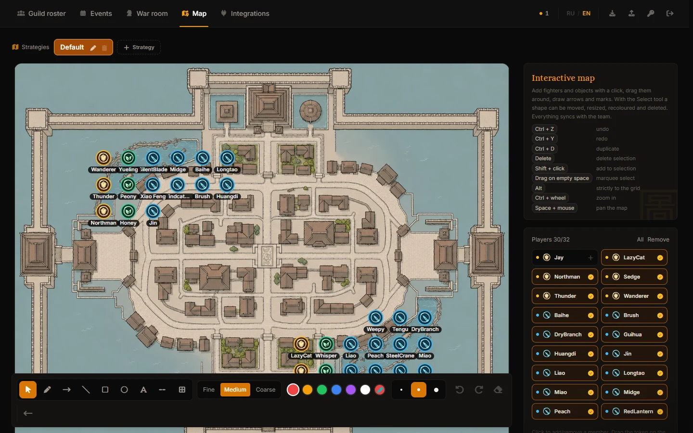

# WWM Guild Manager

Штаб гильдии для **Where Winds Meet** на вашем собственном сервере: состав, события недели с записью, план войны гильдий 30 на 30 и тактическая карта. Всё в одном месте, и вся гильдия видит изменения вживую.

[English version](README.md)



## Возможности

- **Состав гильдии** — роль (танк / хил / ДД), две школы оружия, отметки коллера и рейд-лидера, статус «в отпуске».
- **События и запись** — праки, ранкед и лига. Игроки отмечаются сами: иду, под вопросом или на замену.
- **Штаб войны** — 30 бойцов на атаку и деф, по три пачки из пяти, с линиями и башнями. Автозаполнение ставит людей туда, где они обычно играют, по истории прошлых войн.
- **Тайминги леса и босса** — кто куда идёт на каждой минуте боя.
- **Приказ на бой** — состав и тайминги картинками, чтобы выложить в Discord.
- **Тактическая карта** — расстановка на карте крепости со стрелками, зонами и подписями; несколько стратегий на событие.
- **Бот Discord** — анонсы событий с кнопками записи, регистрация игроков, напоминания в личку, вход на сайт через аккаунт Discord.
- **Бот Telegram** — те же анонсы и запись для гильдий, которые живут в Telegram.
- **Записи ГВГ** — игроки заливают видео боёв на YouTube-канал гильдии прямо с сайта; галерея собирает их в одном месте.
- **Живая синхронизация** — изменения видны всем сразу, без перезагрузки страницы.
- Интерфейс на **русском и английском**, переключается в любой момент.

| Состав | События |
|---|---|
|  |  |



## Установка

Нужен сервер (VPS) с **Ubuntu 22.04+ или Debian 12**, от **1 ГБ памяти** и доступом root. Хватит самого дешёвого тарифа любого хостинга. Домен не обязателен.

Подключитесь к серверу по SSH и выполните одну команду:

```bash
curl -fsSL https://raw.githubusercontent.com/X4vi3/WWM-GuildManager/main/install.sh | sudo bash
```

Установщик задаст три вопроса:

1. **Язык** установщика.
2. **Как будет открываться сайт:**
   - бесплатный адрес вида `203-0-113-7.sslip.io` — HTTPS и всё работает сразу (по умолчанию);
   - свой домен — заранее создайте у регистратора A-запись на IP сервера;
   - без домена, просто `http://` по IP — не будут работать бот Discord, вход через Discord, загрузка на YouTube и копирование картинок в буфер.
3. **Пароль офицеров** — нажмите Enter, и установщик придумает случайный.

Через пару минут он выдаст ссылку на сайт и пароль офицеров. Всё остальное — Node.js, веб-сервер Caddy, HTTPS-сертификаты, системная служба — настраивается само.

### После установки

- Обычная ссылка открывает сайт для гильдии. **Офицеры** открывают `https://ваш-сайт/#admin` и вводят пароль, чтобы редактировать.
- Пароль можно сменить на сайте (значок ключа в верхней панели).
- Боты и YouTube подключаются на вкладке **Интеграции**, доступ к серверу для этого не нужен. Пошаговая инструкция по Discord: [docs/discord-setup.ru.md](docs/discord-setup.ru.md).

### Обновление, смена домена, сброс пароля

Запустите ту же команду ещё раз. Откроется меню:

```
1) Обновить до последней версии
2) Сменить домен
3) Сбросить пароль офицеров
```

Данные гильдии при этом сохраняются.

### Резервные копии

Все данные гильдии лежат в одной папке: `/var/lib/wwm`. Чтобы сделать копию, скопируйте папку; чтобы восстановить — положите её обратно и выполните `chown -R wwm:wwm /var/lib/wwm && systemctl restart wwm`. Ещё на сайте есть экспорт и импорт состава и событий (стрелки в верхней панели).

### Если что-то не работает

| Проблема | Что делать |
|---|---|
| Установщик остановился с ошибкой | Он показывает причину; полный журнал — в `/var/log/wwm-install.log` |
| Сайт не открывается | `systemctl status wwm` и `journalctl -u wwm -n 50` |
| Не работает HTTPS | Проверьте, что A-запись домена указывает на сервер; Caddy сам продолжает попытки. Журнал: `journalctl -u caddy -n 50` |
| «Порты 80/443 уже заняты» | На сервере работает другой веб-сервер (nginx, apache). Остановите его или используйте отдельный сервер |
| Забыли пароль офицеров | Запустите команду установки ещё раз → «Сбросить пароль офицеров» |

Установка без вопросов (для скриптов):

```bash
curl -fsSL https://raw.githubusercontent.com/X4vi3/WWM-GuildManager/main/install.sh \
  | sudo WWM_LANG=ru WWM_ACTION=install WWM_DOMAIN=guild.example.com WWM_PASSWORD=change-me bash
```

`WWM_DOMAIN` — домен, `sslip` (бесплатный адрес, по умолчанию) или `none` (http). `WWM_ACTION` — `install`, `update`, `domain` или `password`.

## Помощь от ИИ-ассистента

В репозитории есть скилл для ИИ-ассистентов (Claude, Codex, Cursor и других): [skills/wwm-guild-manager](skills/wwm-guild-manager/SKILL.md). Дайте ассистенту доступ к серверу или к коду и попросите установить, обновить или починить сайт — скилл подскажет ему, где что лежит и что нельзя ломать.

## Разработка

Нужен Node.js 20+.

```bash
npm install
EDIT_PASSWORD=dev node server/index.mjs   # бэкенд на :3001
npm run dev                                # фронтенд на :3000, /api проксируется на бэкенд
npm test                                   # тесты
```

Фронтенд — React 19, TypeScript, Vite и Tailwind; сервер — Node.js без зависимостей, данные хранит в JSON-файлах.

## Лицензия

[MIT](LICENSE). Лицензия распространяется на код; игровые иконки и название игры принадлежат их правообладателям.

## Благодарности

Основано на проекте [Where Winds Meet Guild Manager](https://github.com/The-Wizard-Coder/Where-Winds-Meet-Guild-Manager) от The-Wizard-Coder.

Where Winds Meet и игровые иконки принадлежат их правообладателям. Это фанатский инструмент, не связанный с разработчиками и издателями игры.
